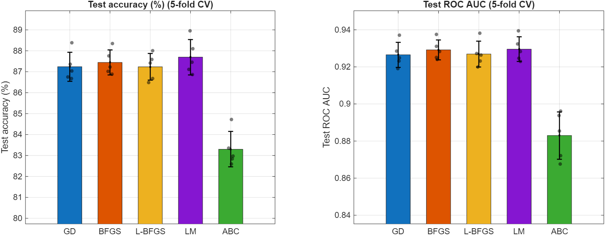
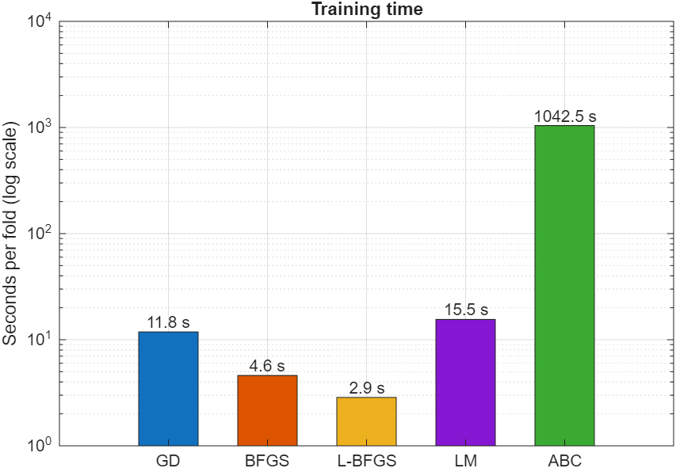

# MAGIC Gamma Telescope: one MLP, five optimizers written from scratch

This MATLAB project trains the same neural network with five different
optimization algorithms and compares them fairly on the UCI
[MAGIC Gamma Telescope](data/README.md) dataset (19 020 samples, 10 features,
gamma vs. hadron).

| Method | Type | Uses |
|---|---|---|
| **GD** | first order, full batch, classical momentum | gradient |
| **BFGS** | quasi-Newton, dense inverse Hessian, Armijo line search | gradient |
| **L-BFGS** | limited-memory quasi-Newton (m = 10), two-loop recursion | gradient |
| **LM** | Levenberg–Marquardt with the Gauss–Newton matrix `J'·diag(p(1−p))·J` | gradient + Jacobian |
| **ABC** | Artificial Bee Colony (Karaboga 2005), population based | loss values only |

No toolbox optimizer is used. Forward pass, backpropagation, the Jacobian,
every optimizer, stratified CV, AUC and ROC are implemented in [`src/`](src/)
using base MATLAB only.

## Results

Stratified 5-fold CV, network 10 → 32 tanh → 1 sigmoid, `rng(42)`:

| Method | Test accuracy | Test AUC | Test F1 (gamma) | Train accuracy | Time / fold |
|---|---|---|---|---|---|
| GD     | 87.24 % ± 0.69 | 0.927 ± 0.007 | 0.905 | 88.06 % | 12 s |
| BFGS   | 87.44 % ± 0.61 | 0.929 ± 0.005 | 0.907 | 88.46 % | 5 s |
| L-BFGS | 87.23 % ± 0.64 | 0.927 ± 0.007 | 0.905 | 87.90 % | **3 s** |
| **LM** | **87.70 % ± 0.84** | **0.930 ± 0.007** | **0.908** | 89.09 % | 16 s |
| ABC    | 83.30 % ± 0.85 | 0.883 ± 0.013 | 0.876 | 83.11 % | 1042 s |



**What the numbers show**

- The four gradient-based methods end up at the same place: all lie within
  0.5 points of each other, which is less than one standard deviation across
  folds. With early stopping on a validation set, the optimizer mainly decides
  *how fast* you get there, not *where* you end up.
- L-BFGS is the fastest (~3 s per fold). LM needs the fewest iterations
  (its best validation loss came after 16–98), but each one builds a 12 933 × 385 Jacobian and solves a 385 × 385
  system, so it is not the fastest in wall-clock time.
- ABC, which never sees a gradient, is 4.4 points behind LM and ~350× slower
  than L-BFGS. Its train and test accuracy are almost equal, so it underfits
  rather than overfits: its validation loss was still going down when it
  reached the 1500-cycle limit in two of the five folds.
- Train/test gaps are small (≤ 1.4 points) for every method, so the L2
  penalty plus early stopping keeps overfitting under control.



## Methodology

1. **No data leakage.** For every outer fold, the test fold is set aside
   first. The rest is split (stratified) into 85 % train / 15 % validation,
   and the z-score scaler is fitted **on the train part only** and then
   applied to validation and test.
2. **Stratified folds**, so every fold keeps the 65 / 35 gamma/hadron ratio.
3. **Same starting point.** Within a fold, every method starts from the same
   Xavier-initialised weights `w0` (ABC uses `w0` as one of its food sources).
4. **Same objective.** Mean binary cross-entropy (computed from the logit with
   a numerically stable softplus) + L2 penalty on weights, `λ = 1e-4`.
5. **Same stopping rule.** Validation cross-entropy is checked after every
   iteration; each method returns its **best-validation** weights. Patience is
   30 iterations (150 cycles for ABC, which improves in small steps).
6. **Reported metrics** are on the untouched test fold: accuracy, ROC AUC
   (rank-based, ties handled), F1 for the gamma class, Brier score, log-loss.

> Hyper-parameters in [`src/default_config.m`](src/default_config.m) were set
> by hand with a few trial runs, not by a nested search, so the absolute
> numbers are slightly optimistic. The comparison between methods is fair:
> they share the same data splits, initial weights, loss and stopping rule.

### Implementation notes

- **BFGS / L-BFGS** follow Nocedal & Wright (Alg. 6.1 and 7.4) with an
  Armijo backtracking line search, initial Hessian scaling `s'y / y'y`, and
  a skip of the update when the curvature condition `s'y > 0` fails.
- **LM** for a classification loss: the Hessian is approximated by the
  Gauss–Newton (Fisher) matrix of the logistic output, damped with `μI`;
  `μ` shrinks ×0.1 after a successful step and grows ×10 after a failed one.
- **ABC** uses the employed / onlooker (roulette on `1/(1+loss)`) / scout
  phases of Karaboga (2005) with a modification rate (Akay & Karaboga 2012):
  each move changes ~2 % of the 385 weights instead of a single one.

## Project structure

```
├── main.m                  # run the full experiment
├── replot.m                # redraw figures from the last run, no training
├── src/
│   ├── default_config.m    # all settings in one place
│   ├── load_magic04.m      # CSV loading and validation
│   ├── stratified_kfold.m  # outer CV folds
│   ├── stratified_holdout.m# inner train / validation split
│   ├── fit_standardizer.m  # z-score, fitted on train only
│   ├── apply_standardizer.m
│   ├── run_experiment.m    # CV loop over all methods
│   ├── mlp_*.m             # init, forward, loss + gradient, Jacobian
│   ├── train_gd.m          # GD with momentum
│   ├── train_bfgs.m        # BFGS
│   ├── train_lbfgs.m       # L-BFGS
│   ├── train_lm.m          # Levenberg–Marquardt
│   ├── train_abc.m         # Artificial Bee Colony
│   ├── line_search_armijo.m
│   ├── early_stopper.m     # validation-based early stopping
│   ├── binary_metrics.m    # accuracy, AUC, F1, Brier, log-loss
│   ├── roc_curve.m
│   └── plot_results.m
├── tests/test_core.m       # unit tests
├── data/                   # magic04.csv + source and license
└── results/                # CSV tables and figures
```

## How to run

Requires MATLAB R2021a or newer. No toolboxes are needed.

```matlab
>> main                     % full experiment, writes to results/
>> replot                   % redraw figures only
>> runtests('tests')        % 14 unit tests
```

The full run takes about **70 minutes** on a 16-thread laptop, and ~98 % of
that is ABC. To try it quickly, lower `cfg.abc.max_cycle` in
`default_config.m` or remove `'ABC'` from `cfg.algorithms`. Besides the two
figures above, `main` also writes `loss_curves.png` and `roc_curves.png`.

The unit tests check the analytic gradient and the Jacobian against finite
differences, that the folds are a stratified partition, that the scaler only
uses the data it is fitted on, AUC against known values, that the CSV loader
rejects bad input, and that every optimizer lowers the validation loss and
returns its best-validation weights.

## References

- R. Bock et al. (2004). *Methods for multidimensional event classification:
  a case study using images from a Cherenkov gamma-ray telescope.* Nuclear
  Instruments and Methods in Physics Research A, 516, 511–528.
- D. Karaboga (2005). *An idea based on honey bee swarm for numerical
  optimization.* Technical Report TR06, Erciyes University.
- B. Akay, D. Karaboga (2012). *A modified Artificial Bee Colony algorithm for
  real-parameter optimization.* Information Sciences, 192, 120–142.
- J. Nocedal, S. Wright (2006). *Numerical Optimization*, 2nd ed. Springer.

## License

Code: [MIT](LICENSE). Dataset: CC BY 4.0, see [data/README.md](data/README.md).
